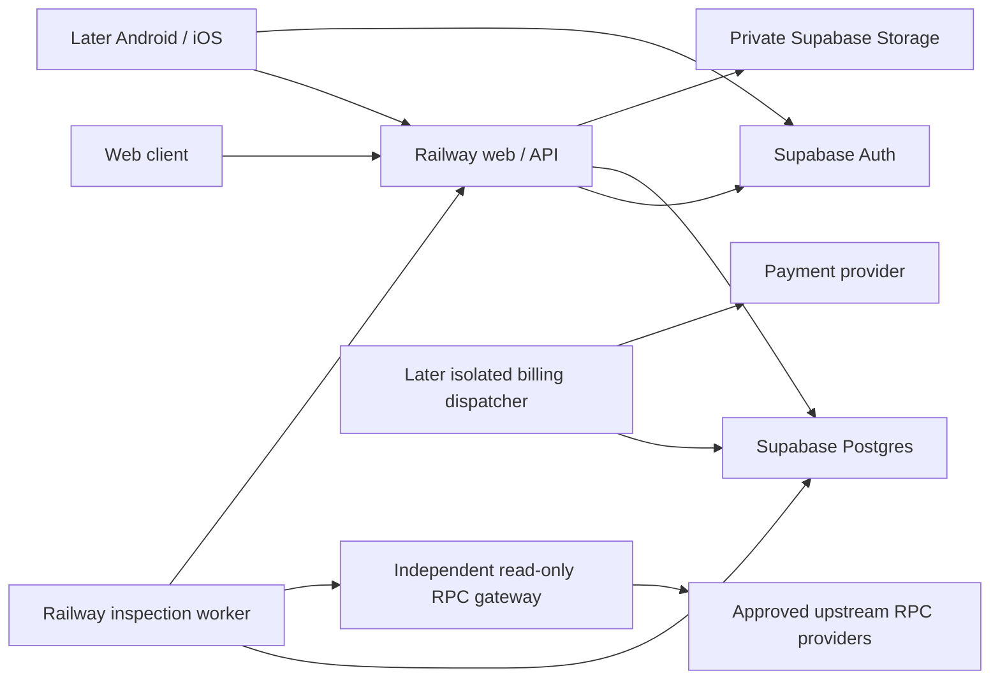

# PITLANE — design specification

Version: 0.2 · 5 October 2026 · **Approved build baseline; implementation in progress. Gateway boundary amendment recorded below.**

PITLANE gives Solana launchpad, token-tooling, and wallet-integration teams a reproducible record of a mint's configuration and whether that configuration meets their declared requirements. The first product is a web application backed by durable jobs, deterministic checks, private evidence, and versioned receipts. Android and iOS will use the same authenticated API later.

The authority for product intent is **Crypto_Agent_Venture_Framework_2026-10-04(1).md**, Library `libfile_c5ff2fbdfbf88191aecabdf7df07c5b6` (775 lines, 48,412 bytes), read in full. This revision uses the saved v0.1 specification and the agreed review corrections; the subsequently pasted attachment was inaccessible and has not been used or bypassed. The implementation plan is a separate document. Version 0.2 resolves delivery-before-capture, field-scoped provider corroboration and bounded read-only TokenMetadata support. Technical choices remain design decisions, not deployed capabilities.

## 1. Scope and non-negotiable outcomes

The first release includes all six product areas: Live Garage, Crew, Service Records, Treasury, Book a Bay, and Manual. Its two versioned templates are `solana.mint_configuration` and `solana.integration_expectations`. It includes authenticated accounts, tenants and project memberships, quotes, idempotent submissions, a durable queue, evidence collection, deterministic verification, private Atlas cases, quota and cost accounting, billing/refund adapters, explicit monitoring controls, and deployment/test contracts.

Every displayed job, event, worker status, receipt, cost, and commercial metric comes from persisted evidence. Empty states remain empty. Fixtures, internal work, sponsored work, test payments, and independently paid customer activity have separate origin classifications. Hosting a worker does not make it an independent external operator.

Required invariants:

1. Tenant and project authorization applies to every read, write, event, search, export, and artifact.
2. Invalid or unsupported declared inputs are rejected before payment capture or quota consumption. Subscription units are reserved, then consumed only for billable delivery. Eligible one-off methods authorize funds and capture only after billable delivery; upfront-capture methods are excluded. Unsupported scope discovered during inspection also has no customer charge.
3. Accepted jobs survive process restarts. Retries cannot create duplicate customer debits, refunds, reservations, receipts for one completion, or work rewards.
4. Missing, stale, malformed, or conflicting required evidence cannot produce a supported aggregate finding.
5. Execution state and finding state are different fields. A completed negative receipt is valid service delivery.
6. Raw observations and issued receipts are immutable while retained. Corrections append a superseding record; deletion is explicit and audited.
7. Inspection has no signing, wallet, custody, transaction construction, simulation, airdrop, or broadcast tool. Its RPC method allowlist contains reads only.
8. AI explanations cannot modify assertions, evidence, billing eligibility, or finding states.
9. Costs and financial obligations are measured and classified separately. Estimated costs, vendor-confirmed costs, and settled customer receipts are visibly distinct.

Deferred: transaction rehearsal, external operators and rewards, token issuance or utility, custody, payouts, on-chain payments, arbitrary source-code execution, custom customer scripts, arbitrary URLs, cross-chain checks, public leaderboards, and a native mobile app. Rehearsal needs a separate validated-path design and must still have no broadcast capability. Each financial or token expansion needs its own authorized setup and review.

## 2. Architecture decisions

| Concern | Decision and reason |
|---|---|
| Application | TypeScript modular monolith in a pnpm workspace. Next.js App Router provides the responsive web UI and `/v1` Route Handlers on a persistent Node server. Domain modules do not depend on React or HTTP. |
| Hosting | Railway web/API service plus a separately deployed inspection worker, both built from the same reviewed commit using Railpack. No local Docker or Dockerfile requirement. |
| Durable state | Hosted Supabase Postgres is the source of truth for jobs, events, authorization, reservations, receipts, accounting, and scheduling. Supabase Auth handles identity; private Supabase Storage holds artifacts. |
| Queue | A narrow Postgres-backed job queue with transactional claims using `FOR UPDATE SKIP LOCKED`, leases, fencing tokens, and persisted retry times. Job creation and reservation commit in one database transaction. No Redis service or in-memory queue is required. |
| Contracts | Shared runtime-validated JSON schemas and TypeScript types, with an OpenAPI document. Zod is the proposed schema library; its exact supported release is pinned and tested when implementation is authorized. |
| Database access | Parameterized SQL through a small Node Postgres driver adapter and reviewed SQL migrations. Queue and ledger atomicity are explicit SQL transactions, not best-effort ORM hooks. |
| Solana | Read-only JSON-RPC adapter and narrowly imported official Solana program codecs. Pin decoder versions; fixture-test raw account decoding. Do not import client signing or sending helpers. |
| Billing | Provider-neutral adapter; proposed first paid provider is Stripe hosted Checkout/Billing plus refunds. Initial development uses a deterministic fake adapter and, when separately configured, Stripe sandbox. Live billing starts disabled. |
| Testing | Vitest for deterministic units and API/adapter contracts; real isolated Postgres for concurrency/RLS/migrations; Playwright for browser acceptance and accessibility checks. No test needs a live customer charge or chain write. |

Next.js supports deployment as a Node server; Railway documents Railpack and monorepo services. Postgres documents `SKIP LOCKED` as suitable for queue consumers, not as a general consistent-read mechanism. These facts support the choices; PITLANE still owns queue correctness and must prove it with the gates below. [Next.js deployment](https://nextjs.org/docs/app/getting-started/deploying), [Railway build configuration](https://docs.railway.com/builds/build-configuration), [Railway monorepos](https://docs.railway.com/deployments/monorepo), [Postgres locking](https://www.postgresql.org/docs/current/sql-select.html).

The worker-to-API connection is a restricted artifact capability endpoint, not a second public customer API. Billing outbox dispatch receives its own process and credentials when live payments are authorized; the inspection process never receives payment credentials. These deployments share domain code and contracts rather than independently evolving business services.

Proposed module boundaries: identity/access, templates/rules, quoting/entitlements, jobs/scheduling, read-only providers, verification, artifacts/receipts, Atlas/permissions, costs, billing/ledger, and audit/events. Shared packages contain contracts, deterministic parsers/rules, and adapters. Web and mobile must call the same domain operations; billing and authorization must not exist only in web server actions.

Exact package versions and a supported Node LTS patch are selected and pinned in a lockfile at implementation time after compatibility/security checks. The discovered Node 24.11.1 and pnpm 11.9.0 prove local tooling availability, not a recommendation to retain those exact patches. No speculative version numbers are part of this design.

## 3. Customer experience and truthful surfaces

| Area | First-release behavior | Backing records and permissions |
|---|---|---|
| Book a Bay | Select project, network, mint, template, and structured requirements; see coverage, evidence policy, quota/unit price, maximum charge, and limitations; explicitly accept quote. | Validated quote and atomic reservation. No wallet connection. |
| Live Garage | Queued/running/verifying states, actual stage events, elapsed time, retry reason, cancellation, and stale-worker indicators. | Tenant-scoped jobs and monotonically sequenced events. Reconnect resumes from the last event cursor. |
| Crew | Dispatcher, Inspector, Verifier, and Recorder stages; deployed capabilities, recent heartbeat, current load, and correctly scoped reliability denominators. | Real worker registrations/attempts. Logical stages may share one process and are labeled as such. Mechanic provides evidence-linked explanations, not autonomous patches. Test Pilot is marked unavailable. |
| Service Records | Immutable JSON and readable receipts, source metadata, assertion evidence, limitations, corrections, comparisons, and authenticated exports. | Authorized receipt versions and artifacts. Atlas cases are accessible here with separate permission controls. |
| Treasury | Customer view: own allowances, reservations, consumption, invoices/refunds when enabled. Operator administration: source-specific service billings, measured costs, obligations, and reconciled balances. | Ledger and usage records. Customers never see platform-wide finances or another tenant's data. Disabled billing is explicitly labeled. |
| Manual | Deployed template/rule coverage, units, outcome language, privacy/retention, monitoring, error and refund policy, and API contracts. | Versioned policy documents linked to the running release and each quote/receipt. No inactive token utility or external-worker earnings claims. |

The design uses an original garage identity with bays, diagnostics, and records; animations follow persisted state changes. Controls support keyboard navigation, focus visibility, reduced motion, clear labels, and responsive layouts. “Supported” means the specified claim is supported by the recorded observations. It is never displayed as universal safety, investment quality, liquidity, audit certification, or guaranteed future execution.

Newly.app, Claude Code, and Cursor are optional authoring tools, not production dependencies or sources of product truth. No tool is invoked by this design. Future UI exports from any builder must meet the same contracts and privacy gates.

## 4. Exact initial template coverage

### 4.1 Common input and evidence rules

One standard unit is **one template, one mint, one network, one bounded acquisition window**. The two templates run separately if both are purchased. A template includes its published assertions within that unit; it is not an unlimited project scan.

Inputs use a full base58 address decoding to exactly 32 bytes, normalized by decode/re-encode, with explicit `mainnet-beta` or `devnet`. Do not require an address to be on-curve; valid program-derived addresses can exist. No aliases, symbols, shortened addresses, arbitrary networks, RPC URLs, or custom code are accepted. The execution network is checked against the configured genesis hash before evidence is accepted.

Only finalized observations are supported. The standard evidence policy requires two separately configured providers with declared upstream identities; two hostnames sharing one upstream do not count as independent corroboration. Offline fixtures have a separate `fixture` evidence policy and can never become live or customer-paid evidence. A single-provider mode is excluded from the initial customer offering.

Each provider returns complete base64 account bytes and context. The parser checks owner program, non-executable mint account, initialization, complete layout, valid option tags, and extension framing. Numeric supplies, slots, epochs, token amounts, and monetary base units are represented as decimal strings in JSON and handled with exact integer arithmetic. Decimals are an unsigned byte, not a promise that a consumer supports that precision.

Version 1 permits the canonical original SPL Token program and Token-2022, with full program IDs taken from official program definitions and pinned into the rule manifest. Arbitrary programs that resemble a token layout are unsupported. [Solana account RPC](https://solana.com/docs/rpc/http/getaccountinfo).

### 4.2 `solana.mint_configuration` version 1

Required output: full mint and network/genesis identity; owner/token program; initialization; decimals; base-unit supply; mint and freeze authority options (full address or explicit null); executable flag; all extension type identifiers; and the following decoded extensions when present:

| Supported extension | Recorded and deterministically checked fields | Scope limit |
|---|---|---|
| `TransferFeeConfig` | Configuration and withdrawal authorities, withheld amount, and both stored older/newer fee schedules including epoch, basis points, and maximum fee in base units. | Configuration evidence only. No claim about a particular transfer, recipient account, hook, or execution result. |
| `MintCloseAuthority` | Optional close-authority address. | Presence/absence is observed; closing the mint is never attempted. |
| `MetadataPointer` | Optional pointer authority and metadata address. | Pointer identity only. External pointed-to accounts and URLs are not fetched. |
| `TokenMetadata` | Embedded mint, optional update authority, name, symbol, URI string and additional key/value entries under the bounds below. | Decode bytes only. No metadata truth, brand identity, website safety or linked-content claim. |

A Token-2022 mint with no extensions is supported. The entire TLV area must be accounted for, with duplicate, truncated, invalid, or inconsistent entries rejected by verification. Every extension other than the four explicitly supported above, including transfer hooks, confidential-transfer features, permanent delegate, default account state, non-transferability, interest-bearing or scaled UI amount behavior, remains outside complete coverage. Record safe base facts and extension IDs without inferring unknown semantics or stripping extensions before compatibility checks. Unknown future extension IDs receive the same treatment.

TokenMetadata decoding follows the pinned official Borsh layout. Bounds are measured in encoded UTF-8 bytes: extension payload at most 16,384 bytes, name at most 128, symbol at most 32, URI at most 2,048, at most 32 additional pairs, key at most 64 and value at most 1,024; the total payload limit still applies. Check length/count prefixes and available bytes before allocation, use strict UTF-8 decoding, reject duplicate additional keys, and account for the full encoded value. The embedded mint must equal the inspected mint; optional authority encoding must match the official codec. The four-extension whitelist and complete-layout checks are unchanged.

Structurally valid metadata exceeding a published bound is unsupported and uncharged; malformed length/encoding, duplicate keys or mint mismatch produces insufficient evidence with a precise parser reason. Preserve strings without Unicode normalization, sort additional entries by exact UTF-8 key bytes only in comparison/canonical projections, and retain original vector order in raw evidence. Render escaped inert text, including visible handling of control/bidirectional characters. Never fetch or activate URI contents. Record whether MetadataPointer points to the embedded mint; an external pointer is a limitation and no assertion about its referenced content is available. [Official TokenMetadata layout](https://github.com/solana-program/token-metadata/blob/main/interface/src/state.rs).

Unknown/unsupported extensions discovered on chain end the job as `unsupported`, with an `insufficient_evidence` diagnostic receipt and no customer charge. Malformed data is `insufficient_evidence`, with a parser reason and quarantined raw bytes; it is not proof of maliciousness. A valid address with no account or a non-mint/wrong-owner account is unsupported and uncharged. Syntactic validation errors never create a billable job.

Successful configuration coverage means required configuration can be deterministically reproduced from the recorded bytes under the pinned parser. Authority presence is a fact, not automatically a failure. Official extension references: [transfer fees](https://solana.com/docs/tokens/extensions/transfer-fees), [close authority](https://solana.com/docs/tokens/extensions/close-mint), [metadata pointer](https://solana.com/docs/tokens/extensions/metadata).

### 4.3 `solana.integration_expectations` version 1

Accept one to 32 declarative predicates against the same supported configuration snapshot. Each predicate is typed and identified; free text can be a private note but never executable policy.

| Allowed predicate | Exact evaluation |
|---|---|
| Mint/network/program identity | Equality against full identifiers, or membership in a non-empty list of the two supported token programs. |
| Decimals | Exact integer equality in 0–255. |
| Mint/freeze/close authority | Explicit equality to a full address or null. Omitted predicate makes no authority claim. |
| Extension policy | Required and forbidden sets, plus an explicit accepted set; all sets contain only v1-supported extension types. Contradiction in the declared sets is an input error. Observed out-of-coverage extensions remain unsupported, not an inferred compatibility result. |
| Metadata pointer | Address/authority equality or null, only within pointer coverage. |
| Embedded metadata | Exact update-authority/address-or-null, name, symbol, URI or named additional-key value equality within the same byte bounds. These compare stored strings, not identity or linked content. |
| Token transfer-fee configuration | `absent`, or a maximum basis-point value in 0–10,000 and maximum fee in nonnegative u64 base units. Caps must hold for **both** recorded schedules. An optional exact equality predicate may target a named stored schedule/epoch. |

Fee checks intentionally cover stored configuration, including scheduled future changes, rather than estimating one transfer's current effective fee. No TransferFeeConfig means no fee from that extension; it says nothing about network, application, or other-program fees. Amount-dependent transfer fees, account-level behavior, wallet support claims, actual integration code, DEX routing, liquidity, transaction effects, and simulation are rejected as unsupported declared requests before reservation.

Each required assertion yields `supported`, `contradicted`, or `insufficient_evidence`, a stable reason code, observed/expected values, and evidence links. Aggregate finding precedence is: any missing/conflicting/out-of-coverage required evidence → `insufficient_evidence`; otherwise any disproven predicate → `contradicted`; otherwise all required predicates supported → `supported`. Empty expectation lists are invalid. Partial contradictions remain visible even when missing evidence makes the aggregate insufficient.

## 5. Observation, conflict, and AI boundaries

The RPC adapter accepts only structured methods necessary for inspection: `getGenesisHash`, `getAccountInfo`, `getSlot`, and optionally `getBlockTime`. All use configured endpoints; no customer-controlled host, path, headers, JSON-RPC method, or payload escapes the adapter. Responses have byte limits, schema validation, TLS verification, deadlines, and secret-redacting error handling. No transaction bytes, keypair inputs, signer interfaces, `sendTransaction`, `sendRawTransaction`, `requestAirdrop`, or simulation methods are exposed.

Fetch a finalized freshness anchor per provider and use it as `minContextSlot` on the account request. This is a lower bound, **not a request for the exact state at a historical slot**. Preserve each observation's actual context slot. The standard window must finish within 180 seconds of queue admission, and paired observations must be acquired within 30 seconds of each other. Observed slot distance is recorded; a proposed maximum skew of 150 slots is a conservative versioned acceptance policy, not a Solana finality guarantee.

Corroboration compares required decoded configuration fields, not complete raw-byte equality. Both providers must independently satisfy network, owner, initialization, account-layout and supported-extension checks. A configuration receipt requires agreement on decimals, mint/freeze authorities, extension type set and the decoded configuration fields of all present supported extensions: fee authorities and both fee schedule configurations, close authority, metadata pointer, and bounded TokenMetadata fields. An expectation receipt additionally checks its predicates but compares only the predicate's required fields plus these structural coverage checks; an unrelated configuration difference is disclosed without inventing an assertion about it.

Supply, TransferFeeConfig withheld amount, lamports and transport/context fields are mutable observations, not compatibility requirements. Preserve each provider's value/slot/time separately. A single corroborated value is emitted only when observed values agree; otherwise mark that informational field `varied` and show both observations. V0.2 does not accept supply/withheld predicates. The aggregate finding depends only on required assertions and structural evidence; it must never imply that all informational values describe one common snapshot. Matching projections at differing slots are limited corroboration, not exact historical state or proof of last modification.

Disagreement in a required field, unsupported extension, malformed structural data, missing required predicate value, wrong genesis, unverified upstream independence or stale/unavailable source cannot pass. A bounded new observation pair may resolve a transient configuration change; preserve and disclose earlier attempts. Unresolved required-field conflict produces insufficient evidence, without majority voting or single-provider downgrade. Publish required projection field paths and hashes in every receipt so the scope of agreement is auditable.

On 429, bounded 5xx, and transport errors, respect Retry-After within the remaining deadline and use exponential backoff with jitter. Authentication failures, invalid response schemas, wrong network, and deterministic parser errors are not repeatedly retried. Circuit breakers prevent a failing provider consuming every tenant's allowance. Shared provider rate/cost reservations are database-backed across worker replicas. Never retry a call unless the remaining job/provider budget covers its maximum configured cost.

Preserve source identity separately from provider identity. Acquisition UTC time is always available; optional block time may be null and is never substituted for acquisition time or mint creation time. A receipt explicitly states that RPC observations are provider reports, not a cryptographic proof of complete chain state.

Verification replays raw bytes through the pinned deterministic rules and checks evidence completeness before publication. In v1, producer and verifier stages may run in the same trusted deployment; record their actual IDs and disclose the lack of independent operator verification. Fixture-based differential tests and human sampling are release controls, not fictitious independent workers.

AI is off by default and optional after deterministic delivery. It receives only permitted, minimal verified fields, with no tools or source-code execution. Provider text and metadata are untrusted data. AI output is separately labeled, versioned, evidence-linked, and subject to retention/consent; if unavailable, a deterministic readable receipt still ships. It cannot add assertions, reinterpret insufficient evidence as success, or authorize money movement.

## 6. Data model and database invariants

IDs are opaque UUIDs. Every tenant-owned row contains `tenant_id`; project-owned rows also contain `project_id`. Composite foreign keys include the tenant and project identifiers, preventing a child row referencing another tenant's parent. Timestamps are UTC `timestamptz`. Hashes include their algorithm/version. JSON is schema-validated, size-bounded, and not a substitute for authorization or financial constraints.

| Tables | Important columns and constraints |
|---|---|
| `tenants`, `tenant_memberships` | Tenant ID, user ID, owner/admin/billing role, membership state; unique tenant/user. At least one active owner; ownership transfer is transactional. |
| `projects`, `project_memberships` | Tenant/project IDs, name, user ID, admin/developer/viewer role; unique project/user; user must belong to tenant. |
| `templates`, `template_versions` | Template ID, immutable version, schemas, supported extensions, rule/parser hashes, evidence policy, budget and refund-policy versions, active/paused status. |
| `provider_profiles`, `provider_health` | Environment/network, provider and upstream identities, genesis identity, secret reference only, configured tariffs, rate limits, last health state. Credentials are never database report content. |
| `quotes` | Tenant/project/actor, normalized inputs/hash, selected template version, request-window key, units, currency/base-unit price/cap, policy versions, expiry, consumed job ID. Quote is single-use. |
| `entitlement_lots`, `entitlement_reservations` | Plan/pilot/internal grant, period, granted/consumed/reserved units; reservation unique per job and lot, immutable settlement reference. Check units are nonnegative and consumed + reserved ≤ granted. |
| `jobs`, `job_attempts` | Scope/input snapshot, canonical work key, idempotency key/hash, origin, state/stage, deadline, ready_at, attempt count, lease owner/until/epoch, cancellation flag, budgets, quote/reservation IDs. Unique scoped canonical key and idempotency key. |
| `job_events` | Tenant/project/job, sequence, event type, safe structured payload, occurred_at; unique job/sequence. Append-only. |
| `workers`, `worker_capabilities` | Deployment/instance ID, build/contract versions, supported packs, heartbeat and actual assignments. No synthetic worker identities. |
| `observations`, `artifacts` | Job/attempt, provider/upstream/network, method/parameter hash, slot/time/commitment, raw artifact digest/size/object key, upload/verification state, retention deadline. |
| `assertions` | Job and receipt version, rule/predicate ID, state, expected/observed typed values, reason code, required evidence links. Frozen at issuance. |
| `receipts`, `receipt_versions` | Stable receipt lineage ID, immutable version ID, job, content hash, renderer/schema/rule versions, artifact manifest, supersedes ID, issued_at. One original issued version per successful job completion. |
| `receipt_relations` | Original/correction/comparison links; same project, no cycles; the current-version pointer changes with compare-and-swap. |
| `monitors`, `monitor_runs` | Frozen accepted inputs/template/evidence policy, interval, enabled_by/at, next_due, allowance/cost limits; unique monitor/scheduled_for. |
| `source_permissions`, `atlas_cases`, `atlas_case_versions` | Project owner, scope of permission, evidence references, generalized content, verification/retraction history. No public scope by default. |
| `cost_reservations`, `cost_events` | Job/provider/global budget, request/attempt identity, amount in micro-USD, measured quantities, tariff version, estimated/measured/reconciled status; unique source event key. |
| `orders`, `order_deliveries`, `payments`, `refunds`, `billing_events`, `outbox` | Adapter/environment/provider IDs, single-unit/pilot order, accepted scope, durable business idempotency keys, authorization ID/expiry/capture limit, delivery references, collection state, amount/currency, webhook ID and reconciliation status; unique provider/account/event and business operation. |
| `ledger_transactions`, `ledger_entries` | Immutable double-entry journal, source type/reference, currency/asset and scale, integer amount, reversal link; balanced debits/credits per transaction/asset/scale enforced in DB. |
| `work_liabilities` | Canonical accepted work/version, beneficiary and liability type, amount/status; unique work/beneficiary/type. External rewards disabled in v1. |
| `audit_events`, `idempotency_tombstones` | Actor, scoped operation, redacted references, time, request hash and prior operation pointer. Access-controlled; no raw secrets. |

Critical indexes cover membership lookups, `(state, ready_at, deadline)` queue claims, lease expiry, tenant/project receipt history, event cursor, due monitors, and unprocessed outbox records. Financial totals cannot be updated by application-supplied balances. Ledger writes occur through one transaction function with duplicate-source protection; corrections reverse and replace instead of editing entries.

## 7. Auth, access, and threat model

Supabase Auth supplies verified identities. The API validates signature, issuer, audience, expiry, and accepted signing keys; JWT claims do not permanently cache project memberships. Every request resolves current membership, including exports and SSE reconnects. Web uses a backend-for-frontend session: the server owns Auth token exchange/refresh, while the browser receives a secure, HttpOnly session cookie with SameSite protections and CSRF checks on cookie-authenticated writes. Do not mix this with a browser-managed Supabase session that requires JavaScript-readable tokens. Login, callback, refresh and logout routes share this session boundary. Later mobile uses authorization-code/PKCE and bearer access tokens kept in platform secure storage. Authentication is never a wallet signature.

Production email login requires separately authorized custom SMTP, sender/domain verification, delivery limits, and bounce handling; the Supabase default email service is restricted to project-team recipients and is not a customer onboarding solution. Each environment has an exact callback/redirect allowlist; production does not use wildcard preview origins. Mobile deep links and OAuth providers are configured only when their clients are added. [Supabase SMTP](https://supabase.com/docs/guides/auth/auth-smtp), [redirect URLs](https://supabase.com/docs/guides/auth/redirect-urls).

Tenant owners/admins intentionally administer all projects in their tenant. Other users require explicit project membership. Project admins manage that project's members and policies; developers quote/submit/cancel their accessible jobs and manage monitors; viewers read accessible evidence. Tenant billing members see entitlements/invoices/refunds but gain no project evidence access by that role alone. Membership removal revokes new requests immediately; active streams recheck at most every 30 seconds and close on revocation.

Postgres tenant tables use RLS with deny-by-default policies. Browser roles cannot directly mutate jobs, quotas, receipts, or accounting. The API database role is non-owner and has no BYPASSRLS; verified actor context is transaction-local and reset by transaction completion. Server authorization still checks project scope. Worker roles can execute narrow queue/artifact/finalization functions only. Functions pin `search_path`, validate lease epoch and scope, avoid dynamic SQL, and are not exposed to public or customer roles. Migrator ownership is separate from runtime roles. [Supabase RLS](https://supabase.com/docs/guides/database/postgres/row-level-security).

Storage buckets are private. Object keys include environment/tenant/project/job/attempt and a generated immutable artifact ID. Workers obtain short-lived, job-bound upload capabilities through an internal authenticated API and cannot enumerate or overwrite other objects. Reads and downloads stream through the API after current authorization; no long-lived customer download URL is stored in a receipt. A storage-administration credential, if required by the selected Storage API, stays only in the server artifact adapter and receives explicit code review because it can bypass RLS. It is never supplied to browsers, mobile clients, or inspection workers. [Supabase Storage access control](https://supabase.com/docs/guides/storage/security/access-control).

| Threat | Required control and verification |
|---|---|
| ID guessing, cross-tenant joins/search/events | RLS plus explicit scope, composite keys, scoped caches, non-disclosing 404s, and two-tenant adversarial tests for every endpoint. |
| Credential or artifact leakage | No provider keys in raw request captures, redacted headers/URLs/logs, private buckets, authenticated export, safe file disposition, no sensitive telemetry. |
| SSRF, broadcast, remote execution | Fixed provider registry and read-method allowlist; no arbitrary URLs, customer scripts, transaction payloads, signers, shell or network tools exposed to inspection. Adversarial adapter tests must reject prohibited methods before HTTP. |
| Stale worker or malicious submission | Lease fencing, strict schemas and size limits, immutable rule versions, bounded evidence, no arbitrary SQL or code. A compromised service credential remains a security incident; application allowlists are not claimed as a host-level sandbox. |
| Forged or stale webhook | Raw-body signature verification, timestamp tolerance, event dedupe, provider-account/environment match, and retrieval/reconciliation against provider state. |
| Cache contamination or XSS | Private responses `no-store`; tenant-scoped cache keys only for safe internal caches; escaped output, CSP, no remote metadata HTML or automatic links fetched by server. |
| Quota races, replay and money duplication | Unique keys and locked budget rows in one transaction; durable business identities beyond provider key lifetime; concurrent replay tests. |
| Operator access misuse | Separate platform administration, least-privilege grants, audit trail, explicit audited support access, and production authentication controls reviewed before launch. |

## 8. Durable job, quota, and idempotency protocol

`POST /quotes` validates syntax, supported declared coverage, current membership, template availability, and request size. It makes no customer charge. Quotes expire after 10 minutes and freeze rule/evidence/price/refund versions. The configured evidence providers must be available for that network before the template can be sold. Quote health checks do not prove that a mint exists; discovery failures remain uncharged as described above.

`POST /jobs` requires `Idempotency-Key` (opaque, 16–128 characters) and the quote ID. In one transaction: check identity/scope, lock quote and entitlement/budget rows in a fixed order, recheck expiry/availability, reserve units and maximum cost, insert the job and initial event, consume the quote, and commit. Insufficient allowance or cost budget rolls back everything. The database is the queue; no second message publish can be lost between commit and enqueue.

Confirmed subscription allowances, already settled pilot retest allowances and explicit internal grants permit immediate queue admission. A one-off order creates an `awaiting_payment` holding job plus a durable authorization outbox request; workers cannot claim it. The admission hold expires after 10 minutes, releasing reservations. Verified authorization, sufficient authorized amount and an expiry covering the accepted delivery window queue it atomically and start the 180-second execution deadline. Late authorization after hold expiry is cancelled/reconciled, never captured or used to resurrect work. No job begins against an unconfirmed authorization, and no request thread waits while holding database locks for a payment provider. Initial pilot work uses an order-bound capacity reservation under its verified authorization, not a fictional paid entitlement.

Idempotency scope is tenant + project + operation. Same key and same normalized request returns the original result; same key with different content returns 409. Request hashes exclude transport metadata and include explicit semantic defaults. Quotes and canonical work IDs are server-generated. The canonical work key includes tenant/project, network/genesis, full mint, template/rule/evidence policy, normalized predicates, and the server's one-minute request-window key. This key deduplicates requests; it does not claim that chain state was captured during that minute. Equivalent submissions in the same window return the same job with no second reservation. A deliberate later rerun gets a new window and quote. There is no cross-tenant job sharing or evidence caching.

States: optional `awaiting_payment → queued`, then `queued → running → verifying → completed`; `retry_wait` may resume running/verifying; `cancel_requested` ends as `cancelled`; terminal alternatives are `unsupported`, `failed`, and `expired`. Incomplete draft inputs are `awaiting_input` at the quote/UI layer, not chargeable queue work. Every transition is conditional on prior state and, for workers, the current lease epoch. `completed` requires an issued receipt and settled reservation, which can be released rather than consumed for an insufficient-evidence report. Billing settlement state is separate.

Claiming locks a due row with `SKIP LOCKED`, increments the lease epoch, records attempt/worker, sets a 60-second lease, and commits before network work. The worker heartbeats every 15 seconds. It checks cancellation, deadline, and remaining budget before every external request. Finalization must verify an unexpired lease and matching epoch; an old worker cannot publish after reassignment. Network calls never hold a database transaction open.

Proposed standard limits, all versioned and tested: 180-second deadline from queue admission including queue wait, at most three execution attempts including lease recovery, at most 16 total RPC requests across all attempts/providers, 8-second individual RPC timeout, 256 KiB raw response cap, two concurrently active jobs per project, and worker concurrency two initially. Retries consume the original cost allowance, not fresh budgets. A reaper atomically requeues expired leases within limits or terminalizes them; heartbeat alone cannot extend the fixed deadline. Resource limits may be reduced before launch but never silently widened on an accepted quote.

The semantics are at-least-once execution with idempotent state changes, not exactly-once network calls. Persist a request-intent/cost reservation before each billable request. A crash after dispatch may leave vendor cost uncertain; retain the maximum reserved exposure and reconcile, rather than assuming zero cost or resetting the budget.

Billable delivery means a complete supported/contradicted receipt is durably published and retrievable through the authorized customer API; it does not require a page view or download. For subscription work, finalization consumes the reserved unit. For a single-unit one-off order, finalization records `delivered_pending_capture` and creates exactly one order/capture outbox operation after the delivery commit. Capture is never triggered by a positive finding alone or before receipt accessibility. Execution can be completed while collection remains pending; the receipt is not revoked or rewritten if collection fails.

Insufficient evidence, unsupported coverage, deadline/system failure or cancellation accepted before the delivery commit releases units and schedules idempotent authorization cancellation. The delivery/cancellation decision is locked transactionally with capture eligibility; after delivery, cancellation returns the completed result and cannot race an independent authorization-release operation against capture. Refund requests after settled delivery are separate operations. Failed capture does not rerun or recharge work, create a new payment identity, charge another method or silently consume extra units. No additional customer charge is introduced by retries or PITLANE-caused corrections.

Idempotency metadata is retained for at least 365 days; financial operation keys follow financial retention. After a payload is deleted, scoped tombstones prevent replay from recreating a charge and return 410 for expired results. Provider idempotency expiry must never permit a new local charge identity.

## 9. API and receipt contracts

Customer endpoints use `/v1`, JSON UTF-8, UTC timestamps, opaque cursors, typed enums, bounded bodies, and decimal strings for large integers. Every request is authenticated except minimal health and versioned public Manual content. Typical body limit is 64 KiB; list pages default to 25 and cap at 100. Rate limits are scoped by user, tenant, and origin/IP, with a separate tighter unauthenticated limit. Errors return `{code, message, request_id, retryable, details}` without secrets or other tenants' existence.

| Endpoint | Request and success contract |
|---|---|
| `GET /v1/templates` | Returns deployed versions, schemas, exact support, limits, and policy links. |
| `POST /v1/quotes` | `{project_id, template_id, template_version, network, mint, expectations?, origin}`; server authorizes origin and returns `{quote_id, inputs_hash, expires_at, units, price, max_charge, evidence_policy, policy_versions}`. Currency amounts are `{asset, scale, base_units}`. |
| `POST /v1/jobs` | Header idempotency key; `{quote_id}`; 202 with `{job_id, execution_state, reservation_id, events_url}`. Replay returns the original job, never a new purchase. |
| `GET /v1/jobs/{id}` | Scoped state/stage, deadline, retry/cancellation status, receipt links, outcome and reservation status. |
| `POST /v1/jobs/{id}/cancel` | Idempotent cancellation request; 202 or current terminal result. |
| `GET /v1/jobs/{id}/events` | SSE with monotonically increasing event ID and resumable `Last-Event-ID`; JSON cursor polling fallback. Authorization precedes stream and is refreshed. |
| `GET /v1/receipts/{id}` | Exact immutable version when `version_id` supplied, otherwise current version plus lineage. JSON/readable/download formats have the same scope. |
| `GET /v1/projects/{id}/changes` | Compares selected receipt versions for the same mint/network and labels rule/evidence-policy changes separately from observed configuration changes. |
| `POST /v1/monitors` | Creates disabled monitor with frozen template/inputs, interval, expiry, monthly units and max-cost allowance. |
| `POST /v1/monitors/{id}/enable`, `/disable` | Idempotent, authorized, audited explicit customer action; enabling rechecks quota/policy and returns effective settings. |
| `GET /v1/projects/{id}/atlas`, `POST /v1/projects/{id}/atlas` | Read or propose a private evidence-linked case. Confirmation, correction, permission and withdrawal operations require project-admin rights. |
| `GET /v1/tenants/{id}/usage`, `/billing` | Scoped allowance/reservation history and financial view permitted by role. |
| `POST /v1/billing/checkout`, `/refunds` | Disabled until billing mode/role/provider setup authorizes them. Durable idempotency required. Refund requests do not claim settlement until confirmed. |
| `POST /v1/webhooks/stripe` | No customer-session auth; signature-authenticated raw-body endpoint with durable inbox and dedupe. |

Validation errors use 422; unauthorized/forbidden use 401/403 where disclosure is safe; inaccessible resource IDs use 404; exhausted quota or idempotency/quote conflicts use 409 with precise reason; rate limits use 429; provider/system unavailability at admission uses 503. Unsupported declared scope uses 422 `UNSUPPORTED_SCOPE`. Execution findings are data, not HTTP errors.

The immutable `pitlane.receipt.v1` payload contains:

- `receipt_id`, `version_id`, `job_id`, `tenant_id`, `customer_project_id`, template/rule/parser/schema/renderer versions, source commit and build identifier.
- Full mint, address role, chain, explicit network and observed genesis identity; normalized input, `inputs_hash`, and evidence-policy version.
- Execution state and aggregate finding separately; typed assertions with rule ID, expected/actual, evidence references, reason codes, and completeness state.
- Every observation's provider ID, upstream ID, configured endpoint alias (never credentials), method/parameter hash, UTC acquisition time, actual context slot, optional block time, commitment, response status, and raw artifact SHA-256; required projection field paths/hash and informational per-provider values/agreement status.
- Artifact manifest with immutable artifact IDs, content types, byte lengths, hashes, retention expiry, and access mode; no credential-bearing URLs.
- Worker/verifier stage identities, attempt IDs, limitations/conflicts, origin, issued time, and optional `supersedes_receipt_id`, `supersedes_version_id`, and correction reason. The receipt ID identifies a lineage; the version ID identifies the exact immutable payload. Superseding references always identify both.
- Cost snapshot showing quantities and then-known measured/estimated/uncertain components, tariff/allocation policy versions, units consumed, and financial references. Later reconciled costs are separate append-only accounting records, not edits to the receipt.

Hash successful raw JSON-RPC response body bytes before parsing; preserve account base64 exactly and never include transport headers or credential-bearing URLs. Error bodies that may echo credentials are retained only as sanitized diagnostics, explicitly labeled as such, not as untouched source evidence. Canonical JSON serialization and SHA-256 define `inputs_hash` and receipt payload digest. The payload excludes its own digest, derived readable-render hashes, and mutable accounting/lineage pointers to avoid circular hashes. The manifest separately hashes the payload and deterministic readable rendering. A digest proves byte identity, not truth or chain finality. Cryptographic issuer signatures are not claimed in v1.

## 10. Evidence publication, correction, retention, and Atlas

Artifacts move through `pending_upload → uploaded → hash_verified → published`. Uploads use unique keys with no overwrite. The API checks exact bytes/digest and job-bound authorization before database finalization. Receipts cannot reference pending/missing objects. Storage and Postgres do not share an atomic transaction: unreferenced uploads are orphaned and cleaned after 24 hours; a database failure leaves recoverable staging records, never a publicly completed job. Hash mismatch or missing evidence blocks completion and customer consumption.

Application roles cannot UPDATE/DELETE published artifact references, observations, assertions, or receipt payloads. A separately authorized retention/deletion role is the only purge path. “Immutable” means application-enforced append-only history within the retention term, not a claimed cloud WORM guarantee.

Correction preserves the previous receipt and adds a new version linked by `supersedes_receipt_id` and `supersedes_version_id` with reason, evidence, actor, and issue time. PITLANE-caused correction is nonbillable and retains the original accounting lineage. A fresh customer configuration rerun is a new job linked for comparison, not a rewrite of history. A systemic false assertion pauses the affected template, identifies impacted records, and queues correction notices in the authenticated product. Email delivery is enabled only under an explicitly configured notification policy.

Proposed first-release retention: raw evidence, receipts, and job events for 90 days after issuance/termination; unconfirmed Atlas drafts for 90 days; confirmed private Atlas cases for 365 days only under an explicit permission covering their necessary retained evidence; redacted security audit and nonfinancial idempotency records for 365 days. Financial retention is a separately versioned business policy reviewed before live billing; that review is not replaced by this design. Users can export within retention. UI and API display expiry dates.

Tenant/project deletion disables monitors and access immediately, cancels pending work, and purges eligible primary-storage artifacts/records within 30 days. Necessary minimal billing/dispute records are separated under the approved financial policy. Backup expiration and storage backup coverage must be disclosed at provisioning; deletion is not represented as instant erasure from backups. Hash-only tombstones are access-controlled and contain no mint, expectation, raw evidence, or user email. If references expire, remaining records state “evidence expired,” never imply replay is still available.

Atlas defaults to private per project. A confirmed case requires a reproducible failure, verified correction, regression fixture, rule/environment versions, and review history. An explanation alone is a proposed fix, not a confirmed fix. Tenant reuse requires explicit scoped permission. Public publication is deferred; generalized content needs separate approval and a redaction review. Withdrawal blocks future reuse and produces a retraction record; it cannot promise recovery of copies already exported under earlier permissions. Public-chain facts do not make customer associations, requirements, traces, or investigation history public.

## 11. Monitoring

Monitors are stored disabled and run only after a project admin/developer explicitly enables a supported policy. Minimum interval is hourly; daily is the proposed default. Every scheduled run is a normal quoted/reserved job, with unique `(monitor_id, scheduled_for)` and a cap on monthly units, maximum unit price, total spend, and expiry. Price, scope, template, or evidence-policy changes require renewed acceptance before further runs.

The worker periodically claims due monitor rows transactionally. Restart catches up at most one missed window per monitor; historical backfill is not automatic. Limits use database time and UTC windows. Missing quota, expired consent, exhausted budget, deleted membership, or paused template holds the monitor with a visible reason rather than creating debt or silently degrading coverage. Disabling stops new submissions and requests cancellation of pending runs.

Differences compare deterministic configuration/predicate values, not AI prose or raw receipt timestamps. In-app notifications contain evidence links; private project details never appear in public feeds. Additional email/mobile/webhook delivery is a later separately configured adapter with destination ownership checks and idempotent delivery.

## 12. Money, quotas, costs, and proposed pricing

All stated prices and budgets are draft configuration. They are not authorization to spend, subscribe, provision paid resources, connect financial accounts, or charge customers.

| Offer | Draft entitlement |
|---|---|
| $199 pilot | One supported integration; up to five initial standard units plus one matching retest of up to five units; one human-reviewed summary capped at 45 minutes. Ten automated units maximum. Human review is tracked as real work. |
| Solo $29/month | Five automated units per billing period. |
| Builder $99/month | Twenty-five automated units per billing period. |
| Studio $299/month | One hundred automated units per billing period. |
| Overage $4/unit | Explicit customer opt-in and a monthly cap; disabled by default. |

Subscription allowance periods follow the confirmed provider billing period, not an invented calendar month. Plan changes use a versioned entitlement adjustment; consumption never resets on retries or webhook duplication. Pilot initial and matching-retest lots are distinct. Customer code/configuration changes outside the agreed retest scope require a new quote.

Billing adapter operations are create checkout/order, authorize eligible one-off funds, confirm provider state, capture after billable delivery, cancel authorization, request post-settlement refund/reversal, and reconcile. Subscription purchases grant allowance only after confirmed settlement; individual inspections merely reserve those units. One-off v0.2 purchases permit only verified manual-capture card methods and enforce the provider-reported capture expiry and amount. No upfront-capture method, automatic-delayed-capture fallback, unsupported payment method or automatic charge against a different saved method is enabled. The allowed methods and actual provider capabilities are reverified before activation. [Stripe separate authorization and capture](https://docs.stripe.com/payments/place-a-hold-on-a-payment-method).

An authorization is not cash received or customer-paid demand. Before publication, an expired/revoked/insufficient authorization blocks billable one-off delivery; finish as insufficient/failure and release capacity. If expiry races a valid delivery, or capture later declines, preserve the delivered receipt and mark collection `authorization_expired` or `collection_failed`. Count no settled revenue. An authorized collection retry uses the same business key while the authorization remains valid; an ambiguous timeout remains `pending_reconciliation` and queries provider state before retry/cancellation. Reconcile any expiry race before concluding that funds were not captured. No new authorization or invoice is silently created; a new customer-approved purchase is needed for a new payment attempt. Settled cash, unpaid delivered-service receivables and failed collection are separate accounting states.

The $199 pilot is one order, not ten separate captures: initial scope is up to five units plus the actually delivered human summary (maximum 45 minutes). Its one capture becomes eligible only when the agreed initial receipt set and summary artifact are accessible and an operator has recorded actual review delivery. The matching retest allowance of up to five units is granted once after confirmed capture and has the accepted order's explicit expiry, proposed as 30 days. If the agreed initial delivery cannot complete within authorization validity, stop and release the hold; never auto-capture for unfinished work. Unsupported/failed automated units remain uncharged, and the exact partial-delivery/refund terms require owner approval before pilot sale. A refundable failed order is not called delivered merely to obtain funds.

All payment operations start from a durable outbox with a unique local business key such as job/capture or payment/refund-sequence, reused as the provider idempotency key. Webhooks are an authenticated inbox, may be duplicated or arrive out of order, and must not independently create extra entitlements. Processing locks the payment/order state and transitions only from valid predecessors. Ambiguous timeouts remain `pending_reconciliation`; query the provider before any retry that could create another charge. Local dedupe outlives Stripe's idempotency-key retention. [Stripe idempotency](https://docs.stripe.com/api/idempotent_requests), [Stripe webhooks](https://docs.stripe.com/webhooks).

Proposed settlement policy: syntactically invalid, unsupported, insufficient-evidence, failed, expired and successfully cancelled work costs zero job units/overage and does not authorize one-off capture. Supported and contradicted complete receipts have the same quoted price. A PITLANE correction adds no charge. Subscription units are released on non-delivery; failed one-off work releases its authorization. Refunds apply only to confirmed settled amounts under approved post-delivery/correction/pilot terms, with unique refund operation keys and a sum not exceeding settled, unrefunded funds. A later discovery that charged delivery was invalid creates a correction and an idempotent compensating refund/credit. Chargebacks create obligations and restricted entitlements, not invented negative usage.

The ledger separates customer deposits, recognized service delivery, tax/processor fees, refunds, disputes, financing/sponsor funding, vendor costs, and any future work liabilities. Each journal balances per currency/asset/scale; conversions require an explicit rate source/time and separate entries. USD customer amounts use cents; granular cost events use micro-USD in a separate ledger scale. No float arithmetic or implicit currency mixing. Test money is excluded from live revenue. Creator fees, token balances, token burns, and market capitalization are not service revenue; their v1 source totals are zero/absent, not estimated income.

No external operator rewards or payouts occur in v1. The future liability model is keyed to canonical accepted work so retries, extra worker identities, self-funded activity, or duplicate evidence cannot earn twice. External operator qualification, independence, dispute, collateral, and anti-coalition reward controls require a separate design before activation.

Cost instrumentation records every RPC request/attempt including failures, response bytes, CPU/wall time, artifact storage byte-days, egress where measurable, AI tokens if enabled, and actual human review minutes. Provider meters/invoices later reconcile estimates through append-only adjustments. Fixed hosting/database costs are explicitly allocated by a versioned policy and reported separately from incremental costs. Unknown cost is unknown, with reserved exposure; it is never zero. Unit economics show both successful-unit cost and total attempted workload cost divided by delivered units, plus refunds/support and excluded expenses.

The framework's $1 automated-unit ceiling ($0.50 production, $0.15 verification, $0.35 platform/retries) and $150 initial demonstration budget are planning proposals, not vendor prices. Cost reservations apply per job, provider, tenant, and environment. Admission and per-call authorization lock budget rows; stop new work when limits or unpriced operations prevent a safe reservation. Hosting fixed charges are not controlled by per-job limits alone. Before paid provisioning, obtain actual Railway/Supabase/RPC prices and approve a separate total spend cap and stop/alert policy. The design makes no promise that the full three-environment stack fits $150.

## 13. Environments and deployment contract

Development, staging, and production use **different Supabase projects**, Auth populations, Storage buckets, Railway environments/services, provider credentials, payment configurations, secrets, and budget counters. A branch or schema in an unrelated production database is not sufficient isolation. Never copy customer production data into development fixtures. URLs and project IDs come from the explicitly selected PITLANE resources; none are silently borrowed from another project or a public production endpoint.

Local deterministic mode runs Node/pnpm, fixture providers, fake auth/payment adapters, and isolated file fixtures without Docker, credentials, or network calls. It is clearly labeled and cannot create live receipt origin. Database/auth/storage integration tests use a dedicated hosted development/test Supabase project after authorized setup. Staging runs complete jobs against its own hosted resources. Local fake adapters cannot be enabled in production; startup fails if environment IDs, adapter modes, or expected genesis/project identity checks disagree.

Current readiness evidence: local Node/npm/pnpm/Bun/Git tooling exists; the assigned workspace started empty. Docker engine availability and WSL restrictions are irrelevant to this design. The parent task verified Supabase read access to four unrelated projects, none PITLANE. The only visible organization is Pro and managed through Vercel Marketplace. Supabase documents that project creation in that organization follows the Vercel dashboard/billing route; the owner must choose that route or a separately authorized standalone organization. The parent task also verified the Railway connection: project listing succeeds and returns zero projects. Neither platform has been provisioned for PITLANE. These are provisioning decisions, not reasons to block deterministic design or later local fixture work. [Supabase Vercel Marketplace](https://supabase.com/docs/guides/integrations/vercel-marketplace).

Railway builds from the repository root so shared packages are available, with service-specific build/start commands and watch paths covering shared dependencies. Node and package-manager versions plus lockfile are pinned. Web binds the provided port; worker starts its queue loop and a minimal internal health endpoint. Only web/API receives a public domain. Persistent data never depends on Railway's ephemeral filesystem. Serverless/autosleep is OFF for the continuous worker when authorized deployment is configured; replicas share database claims, not memory locks. The documented default restart policy is On Failure with ten restarts, and Always is not available on free/trial plans: do not assume unlimited restart recovery. Select the plan/restart policy under the approved cost ceiling and alert when restart exhaustion stops lease recovery. [Railway restart policy](https://docs.railway.com/deployments/restart-policy).

Use small bounded database pools over verified TLS. Prefer a direct connection for persistent services where connectivity permits, or Supabase's session pooler for IPv4-only access. Take actual hosts/usernames from the chosen project's connection settings. Do not invent them. Migrations use a separate credential/session and never run concurrently from every replica. [Supabase connection guidance](https://supabase.com/docs/guides/database/connecting-to-postgres).

The configuration contract includes environment identity, public origin, Supabase URL/project identity and publishable Auth configuration, restricted runtime DB connections, separate migration credential, private bucket identity, provider secret references/genesis/independence metadata, worker budgets, artifact-capability signing secret, and billing/AI feature modes. Secrets are server-only and never baked into client bundles or build logs. Live billing credentials and webhook secret belong only to the later isolated billing dispatcher/webhook adapter. No credentials are created by writing this specification.

Migrations are reviewed, versioned, and tested from empty and prior schemas. Additive changes support the previous deployed app/worker during rollout; workers claim only supported contract versions. Destructive migrations require separate approval and a tested restoration path. A deployment readiness check verifies expected schema/config, and a continuous heartbeat monitor detects stuck workers after deployment. Railway deployment healthchecks alone are not treated as continuous monitoring. Graceful shutdown stops new claims, completes bounded work or lets leases expire, and never marks unfinished work complete. [Railway healthchecks](https://docs.railway.com/deployments/healthchecks).

Backups must cover both Postgres metadata and private artifact objects, with restoration and digest checks in an isolated environment. Proposed service targets are RPO ≤24 hours and RTO ≤24 hours for the pilot, subject to the approved hosting plan and demonstrated restore results; do not advertise them until validated. Alert on oldest queued job, expired leases, provider conflict/outage, missing artifact, nonzero reconciliation backlog, exhausted budgets, and permission failures without including customer evidence in alerts.

## 14. Verification and release gates

These are acceptance criteria, not an implementation plan. Automated checks run with real assertion expectations and deliberately injected failures; passing mock-only tests cannot prove database races, RLS, or hosted delivery.

| Gate | Required evidence |
|---|---|
| Deterministic scope | Golden raw-account fixtures for both programs and all four supported extensions; TokenMetadata byte/count boundaries, malformed prefixes/UTF-8, duplicate keys, embedded mint mismatch, inert hostile URI/text, external pointers, and supported combinations; unknown/duplicate/truncated extensions; invalid address; wrong owner/non-mint/uninitialized accounts; integer/fee boundaries. Unsupported declared requests never authorize customer funds. |
| Honest outcomes | Good declared requirements → supported; valid mismatch → contradicted; missing source, stale evidence, malformed bytes or unresolved provider conflict → insufficient; no missing-evidence pass. Deterministic replay reproduces receipt assertions and hashes. |
| Provider behavior | Simulated 429/Retry-After, 5xx, timeout, wrong genesis, differing slots, stale anchors, source non-independence and budget exhaustion. Supply/withheld-only differences preserve observations without failing configuration corroboration; required-field differences remain insufficient; unrequested differences are disclosed. Prohibited RPC methods and URI fetches fail before dispatch. |
| Durable execution | Kill a worker before/after claim, request, upload, and finalization; restart and recover; race old/new lease epochs; cancel during each stage; exceed deadline; lose Storage or Postgres. No double completion, lost accepted job, or orphan published receipt. |
| Concurrency/accounting | At least 20 concurrent identical submissions and 20 distinct submissions competing for the final allowance; crash/retry captures/refunds; duplicate/out-of-order webhooks; ambiguous payment response; reconciliation after key expiry. Exactly one local reservation/settlement per business operation; budgets never over-allocated. |
| Isolation/security | Two tenants plus restricted project and billing roles across every API, list/search/change feed/SSE, artifact capability and export. Revocation during streams, CSRF, cache isolation, signed-capability misuse, secret redaction, private Storage/RLS and unsupported origin attempts. |
| Corrections/retention | Original stays accessible until expiry; correction links and latest pointer are atomic; platform-caused correction is free; permission withdrawal stops Atlas reuse; delete/expiry leaves honest tombstones and no accessible private artifacts. |
| Monitoring | Disabled monitor does nothing; enabled monitor survives restart; duplicate schedule claims create one job; missed windows stay bounded; price/rule changes, quota and budget exhaustion pause without debt. |
| Web acceptance | Complete Book a Bay → real Garage events → receipt/export flow, all six navigation areas, negative and unavailable outcomes, tenant switching, accessibility, mobile viewport, logout and reconnect. No placeholder activity or revenue. |
| Hosted staging | Authorized independent resources, migration and restore rehearsal, actual two-provider finalized read-only mint receipt, labeled fixtures, artifact replay, measured total costs, and smoke checks on the exact release build. No public production RPC substitution. |
| Paid activation | Authorized provider/account/spend and approved commercial/refund/retention terms; sandbox proof of authorization before work, capture after accessible billable delivery only, expiry/decline/ambiguous-response and cancellation/capture races, one pilot capture and retest grant, refund/subscription/chargeback reconciliation, correct currency/tax handling and owner sign-off. No live charge as a test. |

Vitest and Playwright are selected for reproducible code and browser testing; a live Postgres test database is required for queue/ledger race and RLS proofs. [Vitest guide](https://vitest.dev/guide/), [Playwright installation](https://playwright.dev/docs/intro). Stripe documents testing without live payments; use isolated sandbox data and explicit environment checks. [Stripe testing](https://docs.stripe.com/testing).

Release evidence comprises the supported-check Manual, frozen API/receipt schemas, known-good/bad/unsupported fixtures, real authorized sample receipts, test results, dependency/build identifiers, cost measurements with uncertainty, restore evidence, and reviewed deployment configuration. No production-ready claim is made until the applicable gates pass. Paid billing, mobile, simulation, token, and external operators each retain their additional gate.

## 15. Review decisions and remaining choices

This revision chooses four-extension Token-2022 coverage with bounded read-only metadata, field-scoped two-provider finalized corroboration, nonbillable insufficient outcomes, delivery-before-capture for eligible one-offs, a Postgres queue and an API shared by web/later mobile. The implementation plan maps these decisions to testable tasks; changes to coverage, payment semantics or evidence strength require a new versioned contract.

Only the following external decisions remain before hosted/live activation; none blocks later authorized deterministic fixture work:

1. **Resource ownership and provisioning:** the PITLANE repository owner, Railway account/plan and region, and whether to provision dedicated Supabase projects through the existing Vercel-managed organization or a separately authorized organization. Approve an actual spending ceiling after current quotes; $150 remains a proposal. Production onboarding also needs an authorized SMTP sender/account and exact callback origins.
2. **Evidence providers:** authorize two eligible Solana RPC providers/upstreams, mainnet/devnet access, price/rate limits, data terms, and region alignment. No credentials or public endpoint fallback are assumed.
3. **Commercial activation:** owner acceptance of prices/entitlements and non-delivery policy, retention and financial-record obligations, permitted payment methods/currency/tax setup, and later authorization of the Stripe account and live mode. The $199 pilot's human-review/refund terms need confirmation before sale.

Jeremy approved end-to-end implementation on 5 October 2026. Execute the companion plan continuously. Only the external activation decisions above remain gated; no additional spec approval is required.

## 16. Independent read-only gateway amendment
The inspection worker calls only a separate authenticated gateway; upstream endpoints and provider credentials belong exclusively to that gateway. The gateway validates the four read methods, parameters, current lease and a durable priced request intent before dispatch. It rejects redirects and caller-supplied endpoints/headers. Independent network policy must deny worker access to public RPC, TPU/QUIC and other Internet relays, permitting only its scoped database, artifact API and gateway. A worker application allowlist alone does not prove a compromised worker cannot broadcast. See docs/no-broadcast-boundary.md. Deployment egress enforcement is UNVERIFIED until actual denied-access probes are observed on approved infrastructure; production activation remains blocked without this proof.
